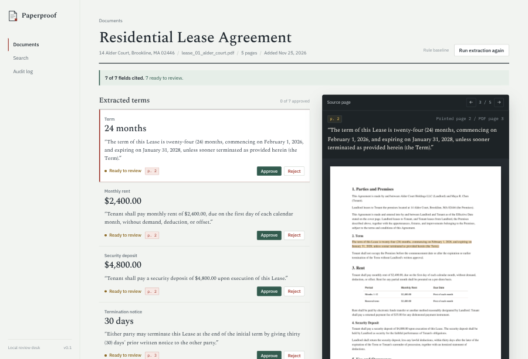
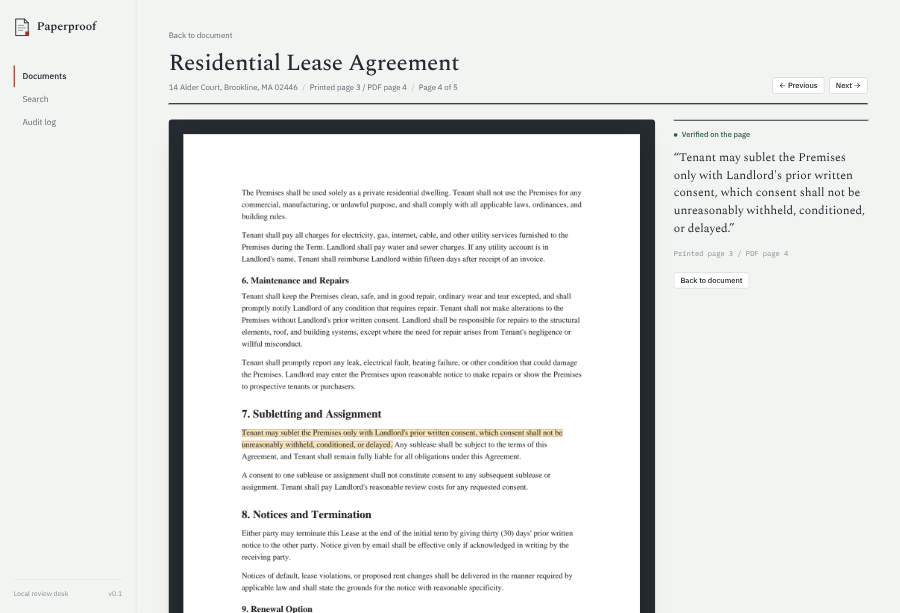

# Paperproof

**Terms with receipts.** Document intelligence where every answer is page-checked.

Paperproof extracts structured terms from lease PDFs, then proves each value with a verbatim quote, the exact page, and a highlight box that is verified against the PDF text layer. If a quote cannot be found, the field is marked unverified and no citation is drawn. If the document is silent, the field is marked "Not addressed" instead of guessed.



The source view is the other half of the contract: the quote sits beside the page, and the clause is highlighted only after the text match succeeds.



## Why this exists

Most document AI is a chat box with a confidence problem. It sounds right, cites nothing, and gives a reviewer no way to check the work. Paperproof is built around the opposite contract:

- **Citation or it did not happen.** Every value is persisted with a quote, a page, and boxes. The quote is matched against the page text before it reaches the UI.
- **Abstention is a feature.** A missing clause is reported as missing. A scanned page is flagged, not hallucinated.
- **The review is the workflow.** Approve or reject each field. Every decision lands in an audit log.
- **Evals before prompts.** A 29 case golden set measures answer accuracy, citation rate, exactness, and false confidence.

The rule-based extractor runs with no API key, which keeps the demo and tests hermetic. Point it at any OpenAI-compatible model to use the LLM extractor.

## Quickstart

```bash
uv sync
uv run paperproof demo
uv run paperproof serve
```

Open http://127.0.0.1:8000. `demo` generates five synthetic leases, ingests them, extracts seven terms from each text-based document, and leaves the review queue ready. No keys, no external services.

Other entry points:

```bash
uv run paperproof samples --force     # regenerate the corpus
uv run paperproof ingest ./path/to/pdfs
uv run paperproof extract <doc_id>
uv run paperproof search "subletting consent"
uv run paperproof eval --verbose     # golden set
uv run paperproof stats
```

## What you can do

- Upload PDFs with the drag and drop tray, or ingest a directory from the CLI.
- Extract term, monthly rent, security deposit, notice period, subletting rules, renewal option, and late fee.
- Click any cited value and see the source page with the clause highlighted.
- Open a full page source view with the verified quote beside it.
- Approve or reject each field, then move to the next pending field.
- Search across clauses with hybrid keyword and embedding retrieval.
- Inspect the audit trail for every ingest, extraction run, and review.

## How it works

```text
PDF
  -> pdfplumber: pages, word boxes, font sizes, printed page labels
  -> section-aware chunking: headings, page ranges, overlap
  -> SQLite FTS5 + hashed embeddings: keyword and vector indexes
  -> hybrid retrieval: BM25 + cosine, fused with reciprocal rank, then reranked
  -> extractor: rule baseline or LLM with structured output
  -> verifier: exact word match, fuzzy fallback, page resolution, highlight boxes
  -> review desk: quote, page image, approve or reject
  -> audit log: who did what, when
```

The trust boundary is `paperproof/extract/verify.py`. Nothing bypasses it. The verified document text is stored as the canonical quote, not the model's version of the quote.

### Printed pages vs PDF pages

Contracts often have an unnumbered cover, so printed page 3 can be PDF page 4. Paperproof detects the printed label and shows both. Citations use the printed label, and the highlight uses the PDF page coordinates.

## LLM mode

The default extractor is a deterministic rule baseline. For production quality, use an OpenAI-compatible endpoint:

```bash
cp .env.example .env
# set PAPERPROOF_LLM_BASE_URL, PAPERPROOF_LLM_API_KEY, PAPERPROOF_LLM_MODEL
uv run paperproof eval --llm
```

Works with OpenAI, OpenRouter, vLLM, and Ollama's OpenAI endpoint. The model receives only the retrieved passages. Its output is parsed into a Pydantic model, its quote is verified, and a failed quote triggers one retry with verifier feedback. If the model is unreachable, the service falls back to the rule baseline and records why.

## Evals

The golden set lives in `evals/cases.jsonl`:

```bash
uv run paperproof eval
```

Current rule baseline:

| Metric | Result |
| --- | --- |
| Cases | 29 / 29 correct |
| Answer accuracy | 100% |
| Citations independently verified | 25 / 25 |
| Exact (not fuzzy) citations | 25 / 25 |
| False confidence | 0 |

The set includes a lease that is deliberately silent on three clauses and a scanned, image-only lease. Both must abstain correctly.

## Limits, stated plainly

- **No OCR.** Scanned PDFs are flagged and extraction is paused. OCR is the next infrastructure step.
- **Lexical embeddings.** The default embedder hashes words, bigrams, and character n-grams. It is deterministic and dependency free. Swap it behind the `Embedder` protocol for semantic recall.
- **Rule baseline.** Rules are fast, offline, and inspectable, but brittle on unusual drafting. The LLM path is the quality path.
- **Single node.** SQLite, FTS5, and in-process rendering. Fine for a team and a few thousand documents. Postgres with pgvector is the scale path.
- **No authentication.** The server binds to `127.0.0.1` by default. Do not expose it without an auth layer.
- **No amendment reasoning.** Version chains and effective dates are modeled in the roadmap, not the current schema.
- **Line-level boxes.** Highlights are unions of word boxes per line, not character-level ranges.

## Project layout

```text
src/paperproof/
  api/            FastAPI app, routes, presenters, Jinja templates, CSS, JS
  extract/        templates, rules, LLM client, verifier, orchestration
  ingest/         PDF parsing, chunking, pipeline
  search/         embedder, indexing, hybrid retrieval
  config.py       typed settings with PAPERPROOF_ prefix
  db.py           SQLite schema, connections, audit helpers
  samples.py      synthetic lease corpus
  evaluation.py   golden-set runner
  cli.py          Typer commands
evals/            golden cases and a thin runner
tests/            unit, integration, API, LLM mock, eval tests
docs/             architecture, screenshots
```

## Development

```bash
make check    # ruff, pyright, pytest, golden set
make test
make lint
make type
make eval
make demo
make serve
```

The test suite covers quote normalization and fuzzy matching, chunking, rule parsers, PDF parsing, ingestion idempotency, hybrid search, extraction, review flow, API rendering, upload, the LLM client with a mock transport, and the full golden set.

## Production roadmap

1. OCR with a queue and page-level confidence.
2. Real embeddings (fastembed, sentence-transformers) behind the existing protocol.
3. Postgres and pgvector, plus object storage for originals and renders.
4. Auth, row-level permissions, and tenant isolation.
5. Effective-date and amendment reasoning with document version chains.
6. Reviewer assignments, bulk actions, and export to CSV or Excel.
7. Parser isolation for hostile PDFs, plus malware scanning.
8. Model routing, cost budgets, and per-field eval slices.

## License

Paperproof is **source-available** under the [Functional Source License 1.1, ALv2 Future License](https://fsl.software/) (`FSL-1.1-ALv2`).

You can read, run, modify, and redistribute it for any purpose except a competing commercial product or service. Internal commercial use is allowed. Each version converts to Apache 2.0 two years after it is published.

This is not an OSI open-source license. It is designed for a commercial product that still wants users to inspect, run, and improve the code. For a competing-use license or another commercial arrangement, open an issue at https://github.com/jimmerioles/paperproof/issues.

Sample documents are synthetic and are not legal advice. Vendored fonts are licensed under the SIL Open Font License; see `src/paperproof/api/static/fonts/OFL.txt`.
